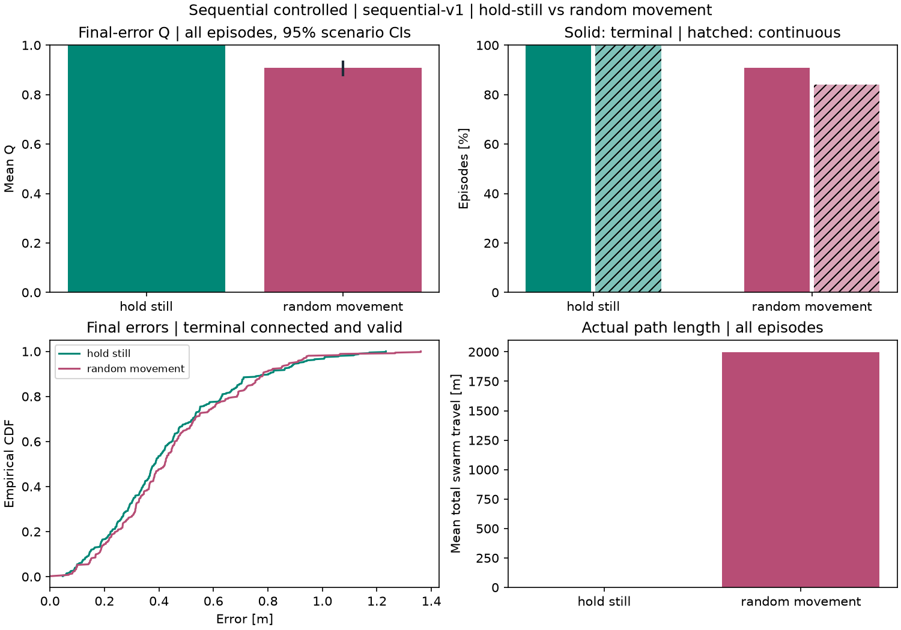

# SWARM-LINK

Reproducible **static and sequential 2D** DoA localization/connectivity experiments. [SPEC.md](SPEC.md) defines project requirements; [IMPLEMENTATION.md](IMPLEMENTATION.md) records numerical rules, benchmark decisions, verified findings and limitations. Sequential hold-still/random movement reuses the existing estimator; learning remains future work.

## Setup and tests

Requires [uv](https://docs.astral.sh/uv/getting-started/installation/). Supports Python **3.12+**; `.python-version` selects the tested **3.14.8**. Only NumPy **2.5.4** and Matplotlib **3.11.2** are direct dependencies; tests use the standard library.

```sh
uv sync --locked
uv run --locked python -m unittest discover -s tests -v
```

Run commands from the project root. `uv sync --locked` creates or updates `.venv` from `uv.lock`, downloading the selected Python if needed. `uv run --locked` uses that environment without shell activation. Dependencies are declared in `pyproject.toml` (replacing `requirements.txt`); `uv.lock` records exact resolved versions and should be committed alongside `.python-version`.

List this project's installed packages with `uv pip list --python .venv/bin/python`. Use `uv add PACKAGE` or `uv remove PACKAGE` to change dependencies and update the lockfile; use `uv sync --locked` after pulling changes. The environment intentionally has no pip installation: bare `pip`/`pip3` can select a different Python, even after activation. Use `uv` commands for this project.

**50 tests pass**: all 36 static/fairness checks plus 14 sequential checks for motion, cumulative history, disconnection/reconnection, pairing, scoring and output protection.

## Sequential movement and cumulative history

Main initial benchmark, **N=5, T=60**, one command:

```sh
uv run --locked python -m swarm_link --experiment sequential
```

Small debugging benchmark, **N=3, T=30**:

```sh
uv run --locked python -m swarm_link --experiment sequential --drone-counts 3 --steps 30 --seeds 11 29 --trials-per-seed 5
```

Both use Δt=2 s, vmax=5 m/s (≤10 m per move), an initial t=0 measurement and one after each move. Main duration is 120 simulated seconds; debug is 60 s. Defaults are provisional engineering choices. Main evaluates 200 paired controlled scenarios, polygon starts, ranges 200/350 m, and two controllers: **800 episodes**. Debug evaluates 40 episodes. Controllers share initial conditions, noise, sensing slots, horizons and movement limits; actual travel/delivery differ.

`--steps`, `--step-seconds`, `--max-speed`, `--drone-counts`, `--initial-formations`, `--ranges`, seeds/counts and initial `--benchmark controlled|randomized` are configurable. `--initial-formations` affects initialization only; drones do not preserve formations. Use `--output` for an alternate run directory. Selecting an existing static benchmark directory is rejected.

| Sequential evidence | Main N=5/T=60 | Debug N=3/T=30 |
|---|---|---|
| Numeric summary and paired confidence interval | [summary.md](results/sequential/controlled/n5-t60/summary.md) | [summary.md](results/sequential/controlled/n3-t30/summary.md) |
| Complete metrics and setting breakdowns | [summary.json](results/sequential/controlled/n5-t60/summary.json) | [summary.json](results/sequential/controlled/n3-t30/summary.json) |
| Protocol, parameters and measurement/outage conventions | [metadata.json](results/sequential/controlled/n5-t60/metadata.json) | [metadata.json](results/sequential/controlled/n3-t30/metadata.json) |
| Matched trajectories and final connectivity | [trajectory.png](results/sequential/controlled/n5-t60/trajectory.png) | [trajectory.png](results/sequential/controlled/n3-t30/trajectory.png) |
| Error, per-drone reachability and delivered history | [diagnostics.png](results/sequential/controlled/n5-t60/diagnostics.png) | [diagnostics.png](results/sequential/controlled/n3-t30/diagnostics.png) |
| Earlier outage followed by terminal recovery | [reconnection.png](results/sequential/controlled/n5-t60/reconnection.png) | [Matched diagnostics](results/sequential/controlled/n3-t30/diagnostics.png) |

Each sequential directory also contains `metrics.png`, `leaderboard.csv`, `by_setting.csv` and four generated raw logs:

- `episodes.csv`: final error/Q, terminal/continuous outcomes, travel and delivered counts for every episode.
- `steps.csv`: all T+1 snapshots, station estimate/diagnostics, reachability and cumulative delivery.
- `drone_steps.csv`: each drone's acquisition position/bearing/noise, delivery, connectivity class/hops/components, requested/actual movement and event flags.
- `drone_episodes.csv`: individual connected fraction, terminal/continuous states, total/longest outage exposure, event counts and travel.

Raw sequential logs are ignored by version control. Main CSVs reproduced exactly across two runs. No static results were regenerated or changed. Definitions and findings are maintained once in IMPLEMENTATION.md §§3.9–4: terminal success permits earlier outages; continuous connectivity is stricter. Final-error Q uses terminal connectivity and validity only. Delivered history survives outages; offline measurements are never backfilled. No RL reward is chosen.



## Reproduce the preserved static benchmarks

Controlled deployment, one command:

```sh
uv run --locked python -m swarm_link --benchmark controlled
```

Randomized deployment, one command (also the default benchmark):

```sh
uv run --locked python -m swarm_link --benchmark randomized
```

| Benchmark | Question | Output directory |
|---|---|---|
| `controlled-v1` | How do formations compare at the same fixed site with nearby transmitters? | `results/controlled/` |
| `randomized-v1` | How robust are formations across broad independent source/deployment draws? | `results/randomized/` |

Each full run evaluates **1,000 paired scenarios × 3 swarm sizes × 3 ranges × 4 formations = 36,000 trials**. Source positions, noise, deployment centre and orientation are matched across formations within each benchmark. Results are never combined into an overall ranking.

Controlled defaults use centre `(500, 350) m` and a uniform-area source disk of radius `75 m`. Change the source region without changing placement or noise streams:

```sh
uv run --locked python -m swarm_link --benchmark controlled --deployment-centre 500 350 --source-radius 150 --output results/controlled-radius150
```

There is no requirement for the source to lie inside a formation. Invalid sampling configurations are rejected before a run; disconnected/invalid **trials are retained**.

A quick separate run:

```sh
uv run --locked python -m swarm_link --benchmark controlled --seeds 7 19 --trials-per-seed 10 --bootstrap-samples 200 --output /tmp/swarm-link-smoke
```

`--help` lists all CLI options. Other numerical settings are explicit in `swarm_link/scenarios.py::Config`. Existing files in an explicitly selected output directory are replaced; use a different `--output` when changing configurations.

## Generated results

| Evidence | Controlled | Randomized |
|---|---|---|
| Numerical summary, primary leaderboard and paired CIs | [summary.md](results/controlled/summary.md) | [summary.md](results/randomized/summary.md) |
| Full machine-readable metrics and failure reasons | [summary.json](results/controlled/summary.json) | [summary.json](results/randomized/summary.json) |
| Formation × swarm-size × range results | [by_setting.csv](results/controlled/by_setting.csv) | [by_setting.csv](results/randomized/by_setting.csv) |
| Per-drone connectivity | [per_drone_summary.csv](results/controlled/per_drone_summary.csv) | [per_drone_summary.csv](results/randomized/per_drone_summary.csv) |
| Primary scene: source, estimate, error, rays and links | [scene.png](results/controlled/scene.png) | [scene.png](results/randomized/scene.png) |
| First disconnected case; diagnostic selection only | [scene_disconnected.png](results/controlled/scene_disconnected.png) | [scene_disconnected.png](results/randomized/scene_disconnected.png) |
| Reference-distance sensitivity | [CSV](results/controlled/quality_sensitivity.csv) / [plot](results/controlled/quality_sensitivity.png) | [CSV](results/randomized/quality_sensitivity.csv) / [plot](results/randomized/quality_sensitivity.png) |
| Protocol, configuration/hash, source region and versions | [metadata.json](results/controlled/metadata.json) | [metadata.json](results/randomized/metadata.json) |

Each directory also contains `leaderboard.csv`, `paired_comparisons.csv`, `trials.csv` and `drones.csv`. Raw logs preserve every trial, paired IDs, positions, bearings/noise, station reachability, drone-only components, estimator inclusion/diagnostics, error and Q. They are generated locally and ignored by Git; compact reports/plots remain versionable. No disconnected image is fabricated if a run has no failed case.

**Metric denominators:** primary Q is the unchanged `L/(L+error)` for valid, fully connected trials and zero otherwise, averaged over **all** trials. `L` remains the environment diagonal. Connectivity and all-trial estimator failure are separate; localization mean/median/RMSE use valid, fully connected cases, with included/excluded counts and connected-only failure rates saved. L sensitivity only rescores the same trials; it does not tune primary Q. Detailed definitions and limits: IMPLEMENTATION.md §§3–4.

The primary scene is preselected (first seed/trial, largest N/range). The disconnected illustration selects the first case where any formation disconnects, showing all four methods on that same case. Neither plot selection changes statistical inclusion. Plot arrows are clipped for display, not a physical sensing-range limit.

Controlled evaluation:


Randomized evaluation:


The different source/deployment priors answer different questions; larger controlled scores do not represent a method improvement. Interpretation, paired differences and postponed investigations are recorded once in IMPLEMENTATION.md §3.9.

## Reproducibility and prior results

The original randomized artifacts remain untouched in `results/` ([original summary](results/summary.md)). Current `randomized-v1` raw trial/drone CSVs are byte-for-byte identical to those original files. Two complete controlled runs reproduced all CSV/JSON outputs exactly.

Metadata records the benchmark protocol (`controlled-v1` or `randomized-v1`), report format (`static-report-v2`), complete configuration/hash and software versions. Compare scenario/case IDs only within the same benchmark/configuration. A protocol version describes sampling/scoring rules, while the configuration hash distinguishes parameters such as source radius. Changed conditions require separate interpretation; no experiment-management framework is involved.

Sensing, connectivity, LS and evaluation accept arbitrary valid positions. Formation/centre/source-prior constraints belong only to initialization; sequential drones may move independently. Further active sensing, learned policies and environmental models remain documented future work in IMPLEMENTATION.md.
