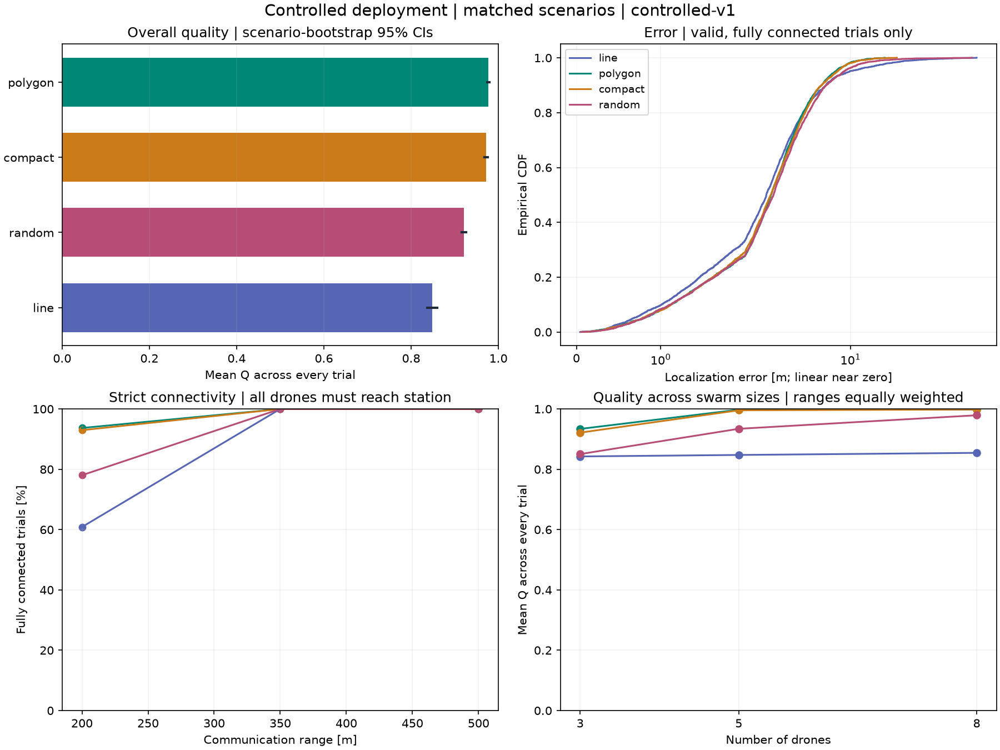
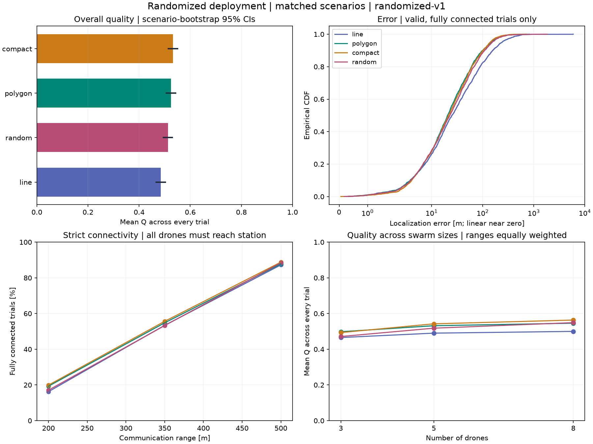

# SWARM-LINK

Two separate **static 2D** benchmarks for DoA localization and ground-station connectivity. [SPEC.md](SPEC.md) defines project requirements; [IMPLEMENTATION.md](IMPLEMENTATION.md) records numerical rules, benchmark decisions, findings, limitations and future research. This iteration adds no movement, learning or new estimator.

## Setup and tests

Requires Python **3.12+**; tested with **3.14.8**, NumPy **2.5.4** and Matplotlib **3.11.2**. Only NumPy/Matplotlib are direct dependencies; tests use the standard library.

```sh
uv venv --python python3.14 .venv
uv pip install --python .venv/bin/python -r requirements.txt
.venv/bin/python -m unittest discover -s tests -v
```

**36 tests pass**, including all 28 original checks and controlled sampling, pairing, scale, reproducibility, arbitrary-position reuse and output checks.

## Reproduce each benchmark

Controlled deployment, one command:

```sh
.venv/bin/python -m swarm_link --benchmark controlled
```

Randomized deployment, one command (also the default benchmark):

```sh
.venv/bin/python -m swarm_link --benchmark randomized
```

| Benchmark | Question | Output directory |
|---|---|---|
| `controlled-v1` | How do formations compare at the same fixed site with nearby transmitters? | `results/controlled/` |
| `randomized-v1` | How robust are formations across broad independent source/deployment draws? | `results/randomized/` |

Each full run evaluates **1,000 paired scenarios × 3 swarm sizes × 3 ranges × 4 formations = 36,000 trials**. Source positions, noise, deployment centre and orientation are matched across formations within each benchmark. Results are never combined into an overall ranking.

Controlled defaults use centre `(500, 350) m` and a uniform-area source disk of radius `75 m`. Change the source region without changing placement or noise streams:

```sh
.venv/bin/python -m swarm_link --benchmark controlled --deployment-centre 500 350 --source-radius 150 --output results/controlled-radius150
```

There is no requirement for the source to lie inside a formation. Invalid sampling configurations are rejected before a run; disconnected/invalid **trials are retained**.

A quick separate run:

```sh
.venv/bin/python -m swarm_link --benchmark controlled --seeds 7 19 --trials-per-seed 10 --bootstrap-samples 200 --output /tmp/swarm-link-smoke
```

`--help` lists all CLI options. Other numerical settings are explicit in `swarm_link/scenarios.py::Config`. Existing files in an explicitly selected output directory are replaced; use a different `--output` when changing configurations.

## Generated results

| Evidence | Controlled | Randomized |
|---|---|---|
| Numerical summary, primary leaderboard and paired CIs | [summary.md](results/controlled/summary.md) | [summary.md](results/randomized/summary.md) |
| Full machine-readable metrics and failure reasons | [summary.json](results/controlled/summary.json) | [summary.json](results/randomized/summary.json) |
| Formation × swarm-size × range results | [by_setting.csv](results/controlled/by_setting.csv) | [by_setting.csv](results/randomized/by_setting.csv) |
| Per-drone connectivity | [per_drone_summary.csv](results/controlled/per_drone_summary.csv) | [per_drone_summary.csv](results/randomized/per_drone_summary.csv) |
| Primary scene: source, estimate, error, rays and links | [scene.png](results/controlled/scene.png) | [scene.png](results/randomized/scene.png) |
| First disconnected case; diagnostic selection only | [scene_disconnected.png](results/controlled/scene_disconnected.png) | [scene_disconnected.png](results/randomized/scene_disconnected.png) |
| Reference-distance sensitivity | [CSV](results/controlled/quality_sensitivity.csv) / [plot](results/controlled/quality_sensitivity.png) | [CSV](results/randomized/quality_sensitivity.csv) / [plot](results/randomized/quality_sensitivity.png) |
| Protocol, configuration/hash, source region and versions | [metadata.json](results/controlled/metadata.json) | [metadata.json](results/randomized/metadata.json) |

Each directory also contains `leaderboard.csv`, `paired_comparisons.csv`, `trials.csv` and `drones.csv`. Raw logs preserve every trial, paired IDs, positions, bearings/noise, station reachability, drone-only components, estimator inclusion/diagnostics, error and Q. They are generated locally and ignored by Git; compact reports/plots remain versionable. No disconnected image is fabricated if a run has no failed case.

**Metric denominators:** primary Q is the unchanged `L/(L+error)` for valid, fully connected trials and zero otherwise, averaged over **all** trials. `L` remains the environment diagonal. Connectivity and all-trial estimator failure are separate; localization mean/median/RMSE use valid, fully connected cases, with included/excluded counts and connected-only failure rates saved. L sensitivity only rescores the same trials; it does not tune primary Q. Detailed definitions and limits: IMPLEMENTATION.md §§3–4.

The primary scene is preselected (first seed/trial, largest N/range). The disconnected illustration selects the first case where any formation disconnects, showing all four methods on that same case. Neither plot selection changes statistical inclusion. Plot arrows are clipped for display, not a physical sensing-range limit.

Controlled evaluation:



Randomized evaluation:



The different source/deployment priors answer different questions; larger controlled scores do not represent a method improvement. Interpretation, paired differences and postponed investigations are recorded once in IMPLEMENTATION.md §3.9.

## Reproducibility and prior results

The original randomized artifacts remain untouched in `results/` ([original summary](results/summary.md)). Current `randomized-v1` raw trial/drone CSVs are byte-for-byte identical to those original files. Two complete controlled runs reproduced all CSV/JSON outputs exactly.

Metadata records the benchmark protocol (`controlled-v1` or `randomized-v1`), report format (`static-report-v2`), complete configuration/hash and software versions. Compare scenario/case IDs only within the same benchmark/configuration. A protocol version describes sampling/scoring rules, while the configuration hash distinguishes parameters such as source radius. Changed conditions require separate interpretation; no experiment-management framework is involved.

The sensing, connectivity, LS and evaluation functions accept arbitrary valid positions. Formation/centre/source-prior constraints belong only to benchmark generation; later drones need not preserve formations. Future stages and research comparisons are documented in IMPLEMENTATION.md and are not implemented here.
