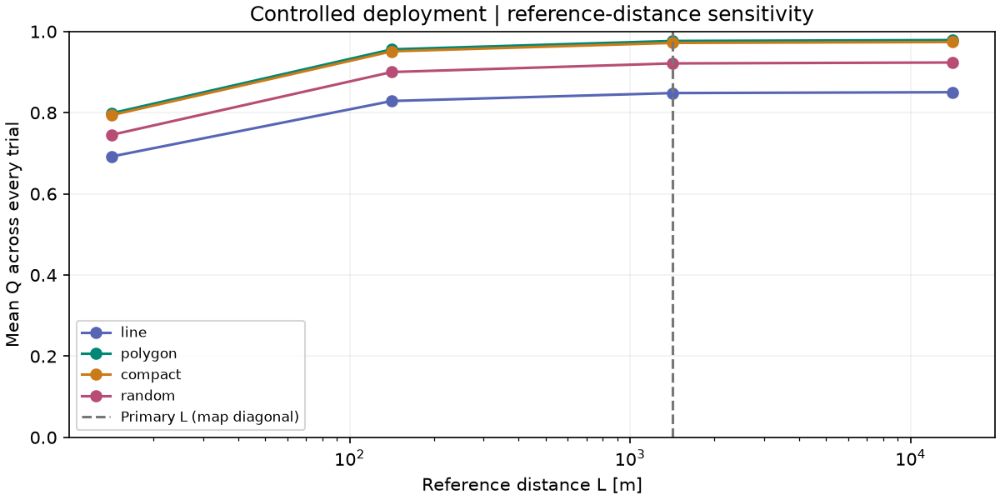
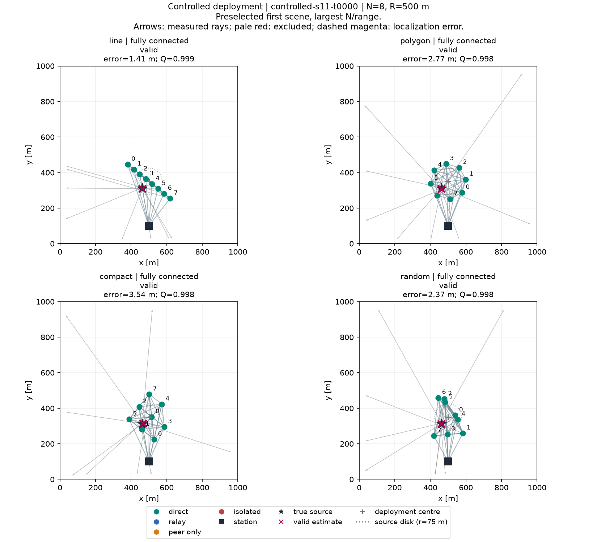
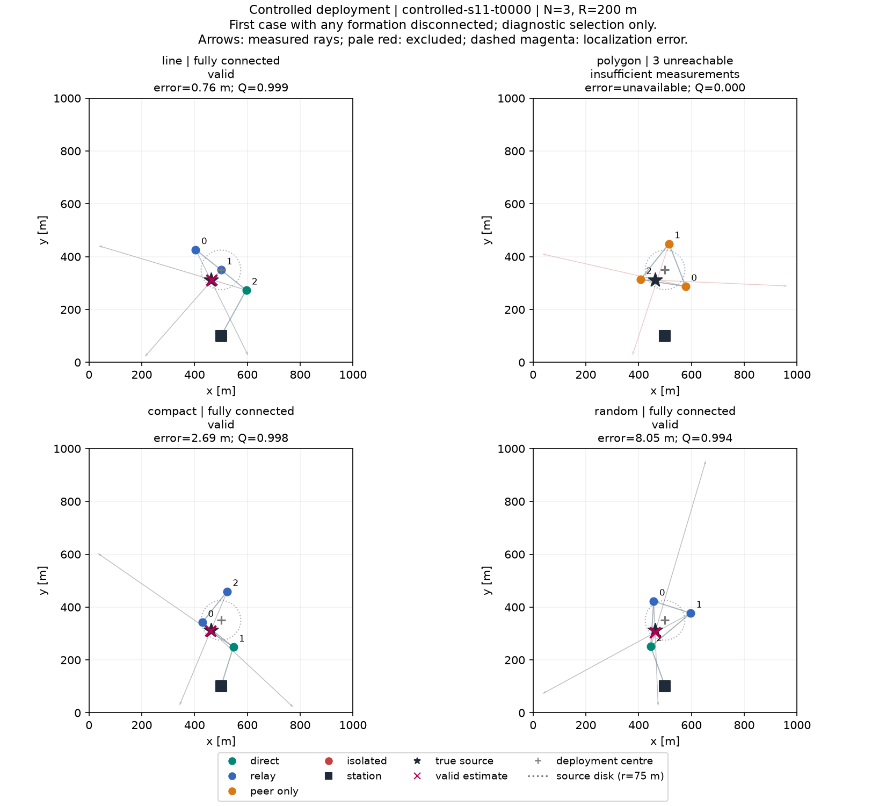

# Controlled deployment — controlled-v1

Fixed centre (500.0, 350.0) m; source uniform in area within a 75 m disk, independent of formation; no convex-hull conditioning.

1,000 paired scenarios; 9 settings per formation; L = 1414.213562 m (environment diagonal).

Q = L / (L + error) for valid, fully connected trials; Q = 0 otherwise. Every trial is included.

| Formation | Trials | Mean Q [95% CI] | Connected % | Estimator failure % | Accuracy n | Mean error m | Median m | RMSE m |
|---|---:|---:|---:|---:|---:|---:|---:|---:|
| polygon | 9000 | 0.9766 [0.9739, 0.9793] | 97.90 | 2.10 | 8811 | 3.45 | 2.98 | 4.13 |
| compact | 9000 | 0.9718 [0.9685, 0.9751] | 97.66 | 2.58 | 8768 | 3.48 | 2.97 | 4.20 |
| random | 9000 | 0.9213 [0.9165, 0.9263] | 92.68 | 6.98 | 8314 | 3.80 | 3.10 | 5.15 |
| line | 9000 | 0.8482 [0.8370, 0.8593] | 86.96 | 14.94 | 7655 | 3.87 | 2.77 | 6.12 |

Errors use valid, fully connected trials only. Estimator failure % uses all trials, including those with insufficient station-reachable measurements.
See summary.json for connected-only estimator failure rates, excluded-case counts, failure reasons and per-seed variability.

## Per-drone connectivity

Percentages below use drone observations, not whole trials. Per-drone IDs and settings are in per_drone_summary.csv; raw components and reachability are in drones.csv.

| Formation | Drone observations | Direct % | Relay % | Peer-only % | Isolated % | Mean unreachable drones/trial | Connected-only estimator failure % |
|---|---:|---:|---:|---:|---:|---:|---:|
| polygon | 48000 | 75.79 | 23.03 | 1.18 | 0.00 | 0.063 | 0.000 |
| compact | 48000 | 70.63 | 28.05 | 1.32 | 0.00 | 0.070 | 0.239 |
| random | 48000 | 70.78 | 24.15 | 4.85 | 0.21 | 0.270 | 0.324 |
| line | 48000 | 68.97 | 18.01 | 13.01 | 0.00 | 0.694 | 2.185 |

## Paired quality differences

Exploratory 95% percentile intervals resample whole scenario IDs, keeping all N/range settings paired. No multiplicity correction or universal winner claim.

| A | B | Mean Q(A) − Q(B) | 95% CI | Evidence in this experiment |
|---|---|---:|---:|---|
| line | polygon | -0.1284 | [-0.1403, -0.1171] | b_higher |
| line | compact | -0.1236 | [-0.1357, -0.1117] | b_higher |
| line | random | -0.0731 | [-0.0855, -0.0604] | b_higher |
| polygon | compact | 0.0048 | [0.0013, 0.0085] | a_higher |
| polygon | random | 0.0553 | [0.0494, 0.0610] | a_higher |
| compact | random | 0.0505 | [0.0444, 0.0565] | a_higher |

## Reference-distance sensitivity

Diagnostic rescoring of the same trials at 0.01, 0.1, 1 and 10 times the map diagonal; primary Q remains at 1×. All failures still score zero. Orders below compare empirical means, not significance. See quality_sensitivity.csv for mean-Q intervals.

| L / diagonal | L [m] | Formation order by mean Q |
|---:|---:|---|
| 0.01 | 14.142 | polygon (0.7983) > compact (0.7937) > random (0.7452) > line (0.6918) |
| 0.1 | 141.421 | polygon (0.9559) > compact (0.9510) > random (0.9000) > line (0.8287) |
| 1 | 1414.214 | polygon (0.9766) > compact (0.9718) > random (0.9213) > line (0.8482) |
| 10 | 14142.136 | polygon (0.9788) > compact (0.9740) > random (0.9235) > line (0.8503) |

