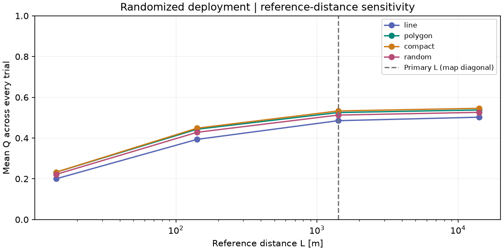
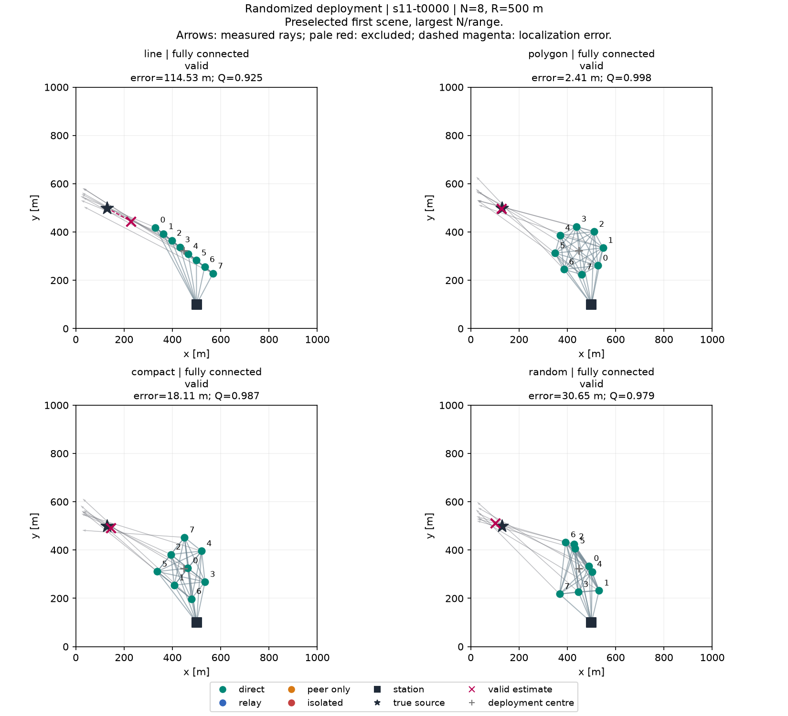
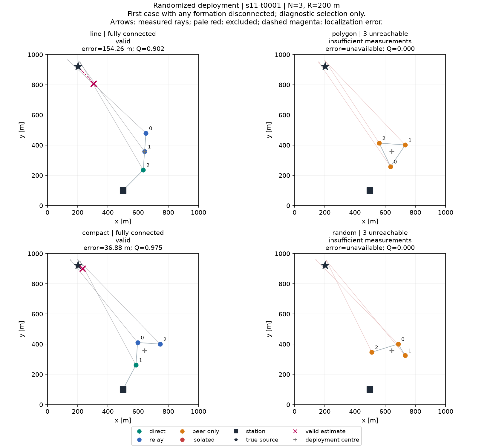

# Randomized deployment — randomized-v1

Source uniform throughout the map; deployment centre independently uniform in the shared safe square.

1,000 paired scenarios; 9 settings per formation; L = 1414.213562 m (environment diagonal).

Q = L / (L + error) for valid, fully connected trials; Q = 0 otherwise. Every trial is included.

| Formation | Trials | Mean Q [95% CI] | Connected % | Estimator failure % | Accuracy n | Mean error m | Median m | RMSE m |
|---|---:|---:|---:|---:|---:|---:|---:|---:|
| compact | 9000 | 0.5330 [0.5143, 0.5502] | 54.77 | 45.24 | 4928 | 40.22 | 21.36 | 65.41 |
| polygon | 9000 | 0.5252 [0.5064, 0.5428] | 53.97 | 46.06 | 4855 | 40.16 | 20.51 | 67.64 |
| random | 9000 | 0.5127 [0.4952, 0.5292] | 52.91 | 47.11 | 4751 | 44.43 | 22.73 | 82.57 |
| line | 9000 | 0.4852 [0.4665, 0.5032] | 52.29 | 49.54 | 4541 | 64.22 | 24.92 | 187.92 |

Errors use valid, fully connected trials only. Estimator failure % uses all trials, including those with insufficient station-reachable measurements.
See summary.json for connected-only estimator failure rates, excluded-case counts, failure reasons and per-seed variability.

## Per-drone connectivity

Percentages below use drone observations, not whole trials. Per-drone IDs and settings are in per_drone_summary.csv; raw components and reachability are in drones.csv.

| Formation | Drone observations | Direct % | Relay % | Peer-only % | Isolated % | Mean unreachable drones/trial | Connected-only estimator failure % |
|---|---:|---:|---:|---:|---:|---:|---:|
| compact | 48000 | 35.11 | 20.63 | 44.25 | 0.00 | 2.360 | 0.020 |
| polygon | 48000 | 35.17 | 19.42 | 45.41 | 0.00 | 2.422 | 0.041 |
| random | 48000 | 35.06 | 19.00 | 45.65 | 0.28 | 2.450 | 0.231 |
| line | 48000 | 35.27 | 17.51 | 47.21 | 0.00 | 2.518 | 3.506 |

## Paired quality differences

Exploratory 95% percentile intervals resample whole scenario IDs, keeping all N/range settings paired. No multiplicity correction or universal winner claim.

| A | B | Mean Q(A) − Q(B) | 95% CI | Evidence in this experiment |
|---|---|---:|---:|---|
| line | polygon | -0.0400 | [-0.0508, -0.0287] | b_higher |
| line | compact | -0.0478 | [-0.0586, -0.0374] | b_higher |
| line | random | -0.0275 | [-0.0381, -0.0165] | b_higher |
| polygon | compact | -0.0078 | [-0.0115, -0.0040] | b_higher |
| polygon | random | 0.0125 | [0.0067, 0.0185] | a_higher |
| compact | random | 0.0203 | [0.0147, 0.0264] | a_higher |

## Reference-distance sensitivity

Diagnostic rescoring of the same trials at 0.01, 0.1, 1 and 10 times the map diagonal; primary Q remains at 1×. All failures still score zero. Orders below compare empirical means, not significance. See quality_sensitivity.csv for mean-Q intervals.

| L / diagonal | L [m] | Formation order by mean Q |
|---:|---:|---|
| 0.01 | 14.142 | compact (0.2326) > polygon (0.2324) > random (0.2215) > line (0.1999) |
| 0.1 | 141.421 | compact (0.4485) > polygon (0.4433) > random (0.4282) > line (0.3935) |
| 1 | 1414.214 | compact (0.5330) > polygon (0.5252) > random (0.5127) > line (0.4852) |
| 10 | 14142.136 | compact (0.5460) > polygon (0.5379) > random (0.5262) > line (0.5023) |

