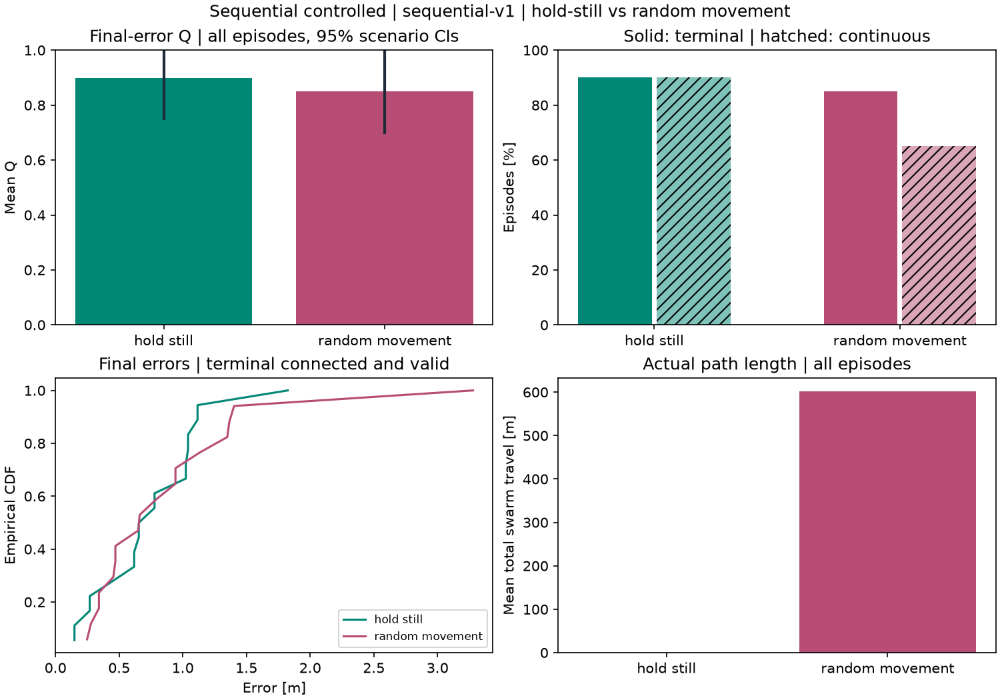
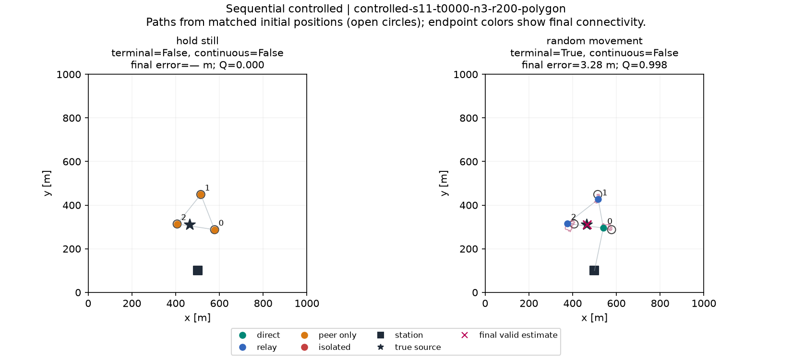
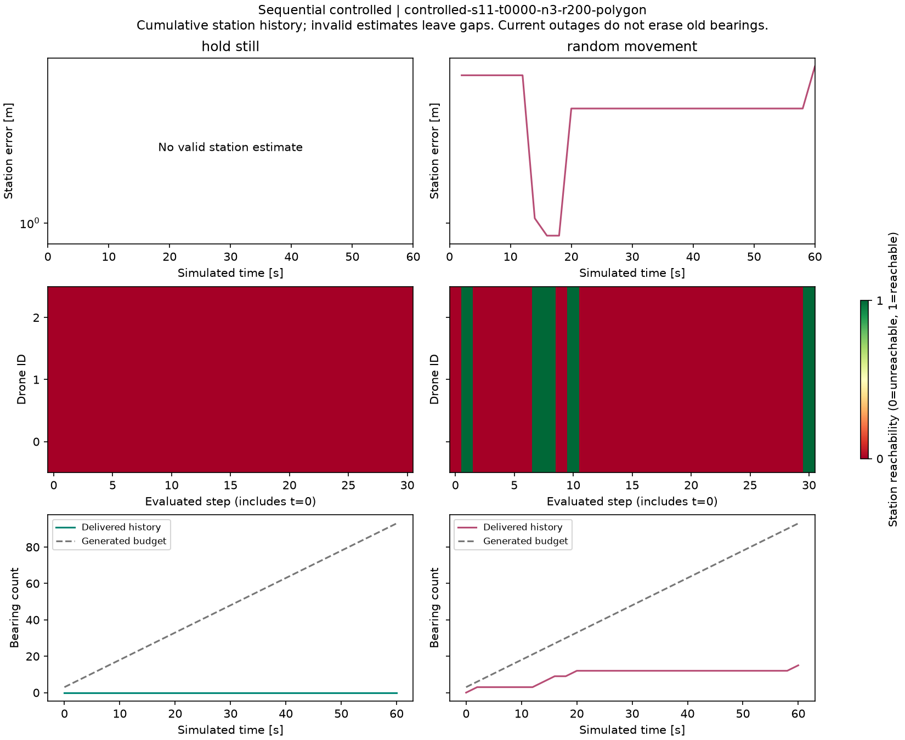

# Sequential controlled — sequential-v1

40 episodes; N=(3,); T=30; dt=2 s; duration=60 s; vmax=5 m/s.

Terminal connectivity and continuous connectivity are separate. Earlier outages do not zero a terminal-successful episode's Q. Final-error statistics below use terminal-connected, valid episodes; quality uses every episode.

| Controller | Episodes | Mean Q [95% CI] | Terminal % | Continuous % | Final estimator failure % | Mean swarm travel m |
|---|---:|---:|---:|---:|---:|---:|
| hold_still | 20 | 0.8995 [0.7496, 0.9995] | 90.00 | 90.00 | 10.00 | 0.00 |
| random_movement | 20 | 0.8495 [0.6995, 0.9989] | 85.00 | 65.00 | 0.00 | 602.56 |

| Controller | Accuracy n | Mean error m | Median m | RMSE m | Swarm-connected snapshot % | Mean swarm outage s | Drone disconnect/reconnect events |
|---|---:|---:|---:|---:|---:|---:|---:|
| hold_still | 18 | 0.75 | 0.72 | 0.86 | 90.00 | 6.00 | 0 / 0 |
| random_movement | 17 | 0.89 | 0.66 | 1.14 | 88.55 | 6.80 | 24 / 24 |

Paired mean Q(random − hold) = -0.05005; exploratory 95% CI [-0.29984556433212994, 0.14987847791938147].

Connected fraction uses T+1 snapshots. Outage seconds sum dt for unreachable left endpoints 0..T-1; final-only outage adds no observed interval. Events use adjacent snapshots; initial outage is not a disconnection event

Raw logs retain all disconnected steps. Per-drone fractions, event counts, exposure and longest outage are in drone_episodes.csv. No early termination or backfilled measurements.

The matched diagnostics already show the selected reconnection case.
