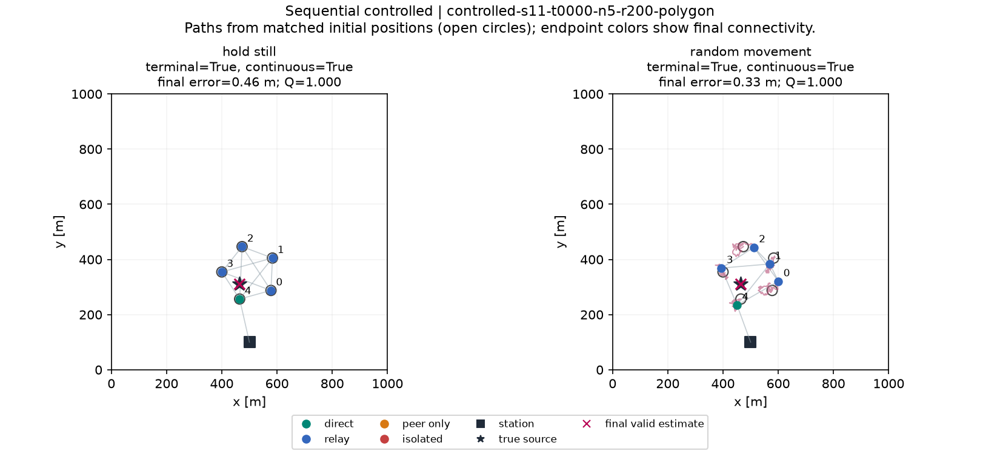
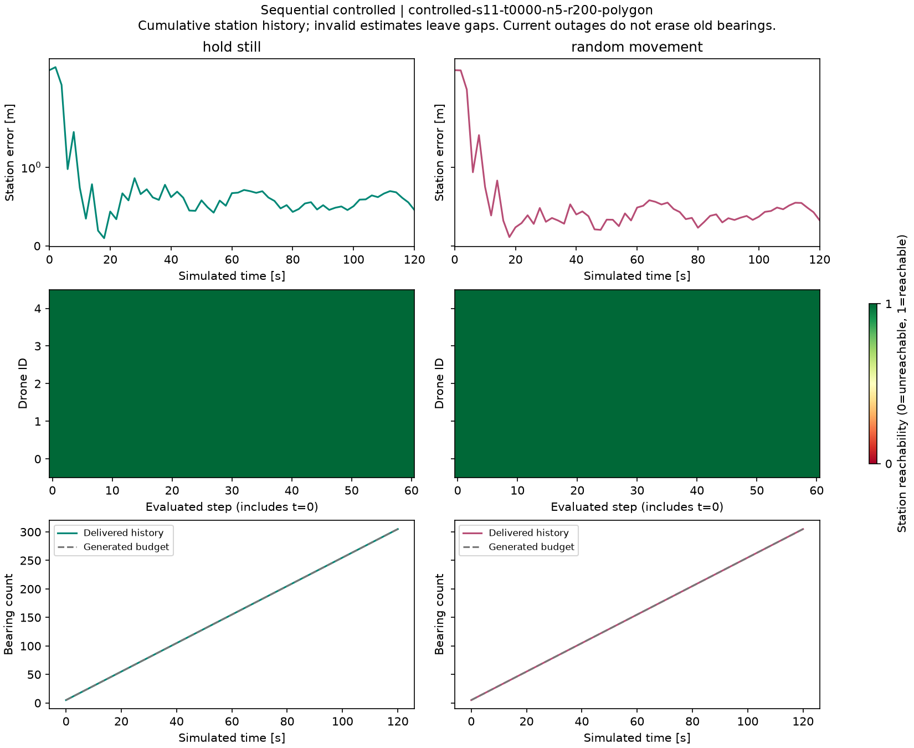

# Sequential controlled — sequential-v1

800 episodes; N=(5,); T=60; dt=2 s; duration=120 s; vmax=5 m/s.

Terminal connectivity and continuous connectivity are separate. Earlier outages do not zero a terminal-successful episode's Q. Final-error statistics below use terminal-connected, valid episodes; quality uses every episode.

| Controller | Episodes | Mean Q [95% CI] | Terminal % | Continuous % | Final estimator failure % | Mean swarm travel m |
|---|---:|---:|---:|---:|---:|---:|
| hold_still | 400 | 0.9997 [0.9997, 0.9997] | 100.00 | 100.00 | 0.00 | 0.00 |
| random_movement | 400 | 0.9072 [0.8797, 0.9322] | 90.75 | 84.00 | 0.00 | 1999.23 |

| Controller | Accuracy n | Mean error m | Median m | RMSE m | Swarm-connected snapshot % | Mean swarm outage s | Drone disconnect/reconnect events |
|---|---:|---:|---:|---:|---:|---:|---:|
| hold_still | 400 | 0.43 | 0.39 | 0.50 | 100.00 | 0.00 | 0 / 0 |
| random_movement | 363 | 0.45 | 0.42 | 0.51 | 97.18 | 3.26 | 598 / 460 |

Paired mean Q(random − hold) = -0.09248; exploratory 95% CI [-0.11998099686474488, -0.06749283817388983].

Connected fraction uses T+1 snapshots. Outage seconds sum dt for unreachable left endpoints 0..T-1; final-only outage adds no observed interval. Events use adjacent snapshots; initial outage is not a disconnection event

Raw logs retain all disconnected steps. Per-drone fractions, event counts, exposure and longest outage are in drone_episodes.csv. No early termination or backfilled measurements.

